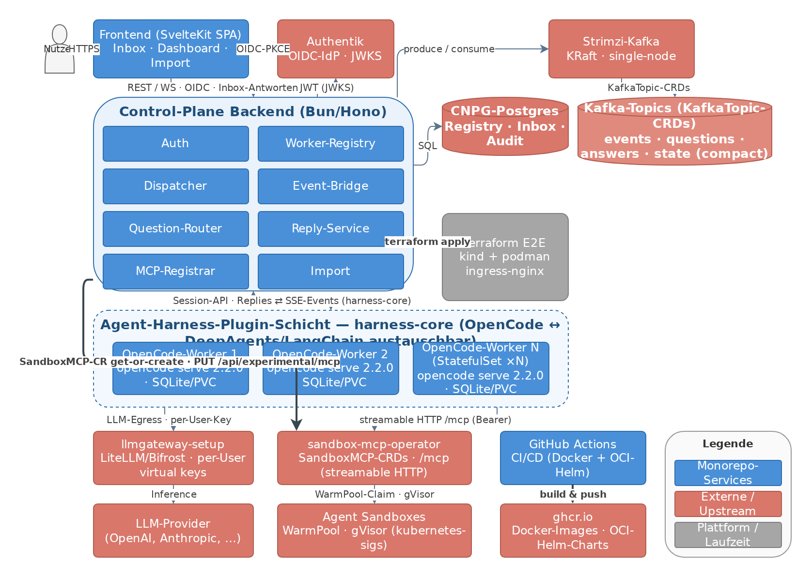

# agent-fleet

[](docs/architecture/agent-fleet-architecture.png)

*Klick auf das Bild öffnet die volle Auflösung. Quelle: [`docs/architecture/agent-fleet-architecture.drawio`](docs/architecture/agent-fleet-architecture.drawio)*

## About

**agent-fleet** ist eine Multi-Session-Control-Plane für OpenCode-Agent-Fleets: Verteilte
OpenCode-2.x-Worker (StatefulSets) werden von einem zentralen Backend über einen
Strimzi-Kafka-Event-Bus überwacht und gesteuert. **Alle Rückfragen** (Permission-Asks,
Forms, MCP-Elicitation) **aller Sessions** landen in einer zentralen Inbox im
Web-Frontend — die Session **blockiert nativ**, bis der Nutzer antwortet (Suspension gratis).
Ein **harness-agnostischer Kern** (`harness-core`) hält das Backend unabhängig vom
Agent-Harness: OpenCode-Worker sind über LangChain-DeepAgents austauschbar oder
erweiterbar, ohne dass Dispatcher, Question-Routing, Reply-Service oder Kafka sich ändern.

Farb-Legende im Diagramm: 🔵 Monorepo-Services · 🔴 Externe/Upstream-Services · ⚪ Plattform/Laufzeit.

## Architektur-Entscheidungen (ADR-Kurzfassung)

| # | Entscheidung | Begründung |
|---|---|---|
| 1 | **Verteilte Worker + zentrales Control-Plane** (Approach A) | Passt zur Sandbox-Vision, Worker austauschbar, kleine Blast-Radius pro Session; Alternativen (SDK-embedded, single Server) verworfen — Details im Spec §4 |
| 2 | **Kafka via Strimzi-Operator** (KRaft, single-node, RF=1) | K8s-native Lifecycle via CRDs (`Kafka` + `KafkaTopic`), gleiche Philosophie wie CNPG; Replay/Durability kompensiert OpenCodes live-only-SSE |
| 3 | **SQLite pro Worker, Postgres (CNPG) nur für Registry/Inbox** | OpenCode speichert zwingend embedded SQLite (`OPENCODE_DB` ändert nur den Pfad); Backend-Metadaten gehören in echtes Postgres |
| 4 | **Kein eigenes LLM im Backend** | Session-LLM-Calls laufen in den Workern; Backend nutzt für interne Aufgaben die One-Shot-Generate-Endpoints einer OpenCode-Instanz |
| 5 | **Suspension = natives Blocking** | Permission-Ask/Form blockiert die Session bis zur Antwort — kein eigenes Pause/Resume nötig |
| 6 | **Harness-Entkopplung (`harness-core`)** | `HarnessClient`-Schnittstelle; OpenCode ist die erste Implementierung, LangChain-DeepAgents (LangGraph-Interrupts als Question-Quelle) später als weiteres Provider-Package; MCP-Registrierung und Session-Import sind optionale Capabilities |
| 7 | **Import admin-only** über offizielle API (`/api/experimental/session/import`) | Kein DB-Parsing, kein Egress auf fremde Endpoints |
| 8 | **OpenCode pinnen: `ghcr.io/anomalyco/opencode:2.2.0`** | `latest` zeigt auf V1 (1.19.4)! Health-Check assertet Version 2.x |
| 9 | **LLM-Egress über bestehendes llmgateway-setup** | LiteLLM/Biforst mit per-User virtual keys (Multi-User soft tenancy) |
| 10 | **1× `SandboxMCP`-CR je Worker** | sandbox-mcp-operator vergibt eine Sandbox pro Server-Lifetime; per-Session-Affinität via `_meta["ai.opencode/sessionID"]` ist Phase 2 |
| 11 | **Frontend SvelteKit 2 (SPA, adapter-static), Svelte 5** | Partner-Präferenz; runes-basierte Stores für WS-Live-Updates |
| 12 | **Push auf `main` = Publish-Side-Effect** | docker-publish + helm-publish-Workflows bauen Images + OCI-Charts nach `ghcr.io/gthieleb/*`; Rollback = ghcr-Package-Version löschen |

## Referenzen

| Repository / Resource | Rolle |
|---|---|
| [anomalyco/opencode](https://github.com/anomalyco/opencode) · [V2-Docs](https://opencode.ai/v2/docs/) | Agent-Harness #1 (Worker-Image `ghcr.io/anomalyco/opencode:2.2.0`) |
| LangChain/LangGraph · [deepagents](https://github.com/gthieleb/deepagents) | Künftiger Harness #2 (`harness-deepagents`, LangGraph-Interrupts als Question-Quelle) |
| [gthieleb/sandbox-mcp-operator](https://github.com/gthieleb/sandbox-mcp-operator) | Bestehender MCP-Service: Agent-Sandbox als hardened Execution-Backend (streamable HTTP `/mcp`, `SandboxMCP`-CRD, WarmPool, gVisor, Bearer-Auth) |
| [kubernetes-sigs/agent-sandbox](https://github.com/kubernetes-sigs/agent-sandbox) | Sandbox-CRDs (`Sandbox`, `SandboxTemplate`, `SandboxClaim`, WarmPools), SIG Apps |
| [gthieleb/agent-sandbox-lab](https://github.com/gthieleb/agent-sandbox-lab) | Vorlage für die Terraform-E2E-Umgebung (kind, gVisor-Node-Image, Controller-Stack) |
| [gthieleb/llmgateway-setup](https://github.com/gthieleb/llmgateway-setup) | LLM-Egress (LiteLLM/Bifrost/Kong + agentgateway-Referenz), per-User virtual keys |
| [gthieleb/authentik-setup](https://github.com/gthieleb/authentik-setup) | OIDC-IdP (PKCE-Login, JWKS-Validierung) |
| [gthieleb/terraform-k8s-cnpg](https://github.com/gthieleb/terraform-k8s-cnpg) | Postgres via CloudNativePG |
| [strimzi/strimzi-kafka-operator](https://github.com/strimzi/strimzi-kafka-operator) | Kafka on K8s (`Kafka`-CRD KRaft, `KafkaTopic`-CRDs) |
| [tehcyx/terraform-provider-kind](https://github.com/tehcyx/terraform-provider-kind) | Terraform-Provider für kind-Cluster (E2E mit podman) |
| Bitnami → Strimzi-Migration, CNPG, ingress-nginx | Plattformkomponenten im Helm/Terraform-Stack |

## Repo-Struktur (geplant — Wave 1ff)

```
apps/
  control-plane/     # Bun + Hono Backend (Dispatcher, Event-Bridge, Question-Router, …)
  frontend/           # SvelteKit 2 SPA
packages/
  fleet-schema/      # zod-Types, Kafka-Topics, drizzle-Schema
  harness-core/      # HarnessClient-Schnittstelle + Registry
  harness-opencode/  # OpenCode-Implementierung (@opencode/client)
charts/               # agent-fleet-{worker,backend,frontend} (OCI nach ghcr.io)
infra/                # Terraform: kind+podman E2E, CNPG, Strimzi, agent-sandbox-Stack
e2e/                  # Smoke-Suite (Session → Question → Reply → Import)
```

## Dokumente

- **Design-Spec:** [`docs/superpowers/specs/2026-10-27-agent-fleet-platform-design.md`](docs/superpowers/specs/2026-10-27-agent-fleet-platform-design.md)
- **Implementierungsplan:** [`docs/superpowers/plans/2026-10-27-agent-fleet-plan.md`](docs/superpowers/plans/2026-10-27-agent-fleet-plan.md)

## Lizenz

MIT (folgt mit Wave 1).
